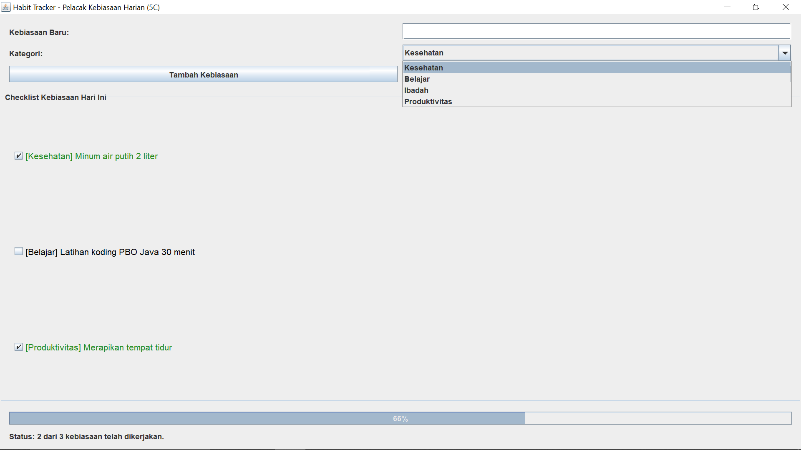

## Komponen GUI yang Digunakan

### 1. Top-Level Container
 JFrame: Digunakan pada class HabitTrackerFrame sebagai jendela utama aplikasi (extends JFrame).

### 2. Intermediate Component
 JPanel: Digunakan untuk mengelompokkan form input di bagian atas (panelInput), menampung daftar checkbox kebiasaan (panelDaftarHabit), serta membungkus area progress bar dan status di bagian bawah (panelBawah dan panelStatus).
 JScrollPane: Membungkus panelDaftarHabit agar daftar kebiasaan dapat digulir (scroll) ketika jumlahnya banyak.

### 3. Atomic Component
 JCheckBox: Komponen untuk menandai apakah suatu kebiasaan sudah dikerjakan (dicentang) atau belum.
 JProgressBar: Menampilkan persentase kebiasaan yang sudah diselesaikan pada hari tersebut secara visual (0% - 100%).
 JTextField: Kolom input untuk mengetikkan kebiasaan baru (txtNamaHabit).
 JComboBox: Pilihan dropdown untuk memilih kategori kebiasaan (cbKategori).
 JButton: Tombol untuk menambah kebiasaan baru (btnTambah) dan mereset seluruh centang harian (btnReset).
 JLabel: Menampilkan label form dan informasi status penyelesaian (lblStatus).
 JOptionPane: Menampilkan pesan popup peringatan apabila kolom input masih kosong saat tombol tambah ditekan.

### 4. Layout Manager
 BorderLayout: Mengatur tata letak utama pada JFrame (NORTH, CENTER, SOUTH) dan pada panelBawah.
 GridLayout: 
   GridLayout(3, 2, 8, 8) pada panelInput untuk menyusun form menjadi 3 baris dan 2 kolom.
   GridLayout(0, 1, 5, 5) pada panelDaftarHabit untuk menyusun JCheckBox berderet vertikal ke bawah.
 FlowLayout: Digunakan pada panelStatus agar label status rata kiri (FlowLayout.LEFT).

### 5. Event Handling (2 Interface)
1. ActionListener:
    Mengimplementasikan method actionPerformed(ActionEvent e) untuk menangani aksi klik pada tombol Tambah Kebiasaan (membuat objek Habit dan JCheckBox baru) serta tombol Reset Centang Harian (memanggil resetSemuaStatus() dan menghapus seluruh tanda centang).
2. ItemListener:
    Mengimplementasikan method itemStateChanged(ItemEvent e) yang mendeteksi setiap kali pengguna mencentang (ItemEvent.SELECTED) atau menghapus centang (ItemEvent.DESELECTED) pada JCheckBox, lalu memperbarui status objek Habit dan nilai JProgressBar.

---

## Screenshot Aplikasi

